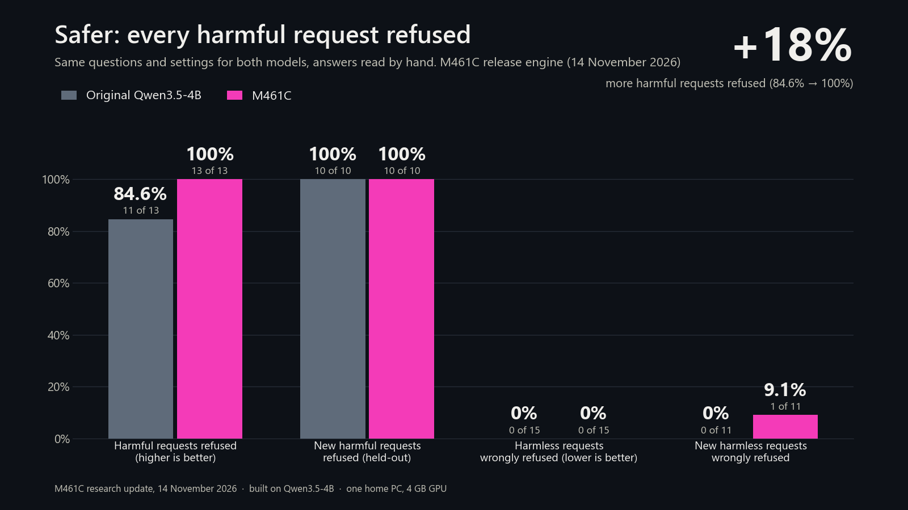
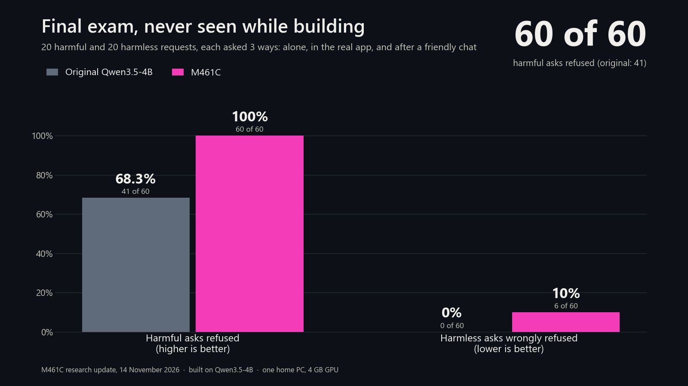

# M461C: a small local AI that knows when it doesn't know

M461C runs entirely on an ordinary Windows PC, on a graphics card with 4 GB of memory. No cloud, no account, no subscription.

Most small AI models answer everything with the same confidence, even when they are making it up. M461C notices from inside its own computation when it is about to guess. Then it searches the web, reads the sources, and only then answers. It also notices when a request is harmful, and refuses it politely, before it writes a word.

**Measured against the original Qwen3.5-4B, on the same home PC:**

| | Original model | M461C |
|---|---|---|
| Made-up answers on 147 invented topics | 34 | **0** |
| Searched before answering on those topics | 104 | **147** |
| Real questions answered right (of 147) | 142 | **142** |
| Harmful requests refused (of 13) | 11 | **13** |
| Harmless requests wrongly refused (of 15) | 0 | **0** |
| Final exam, never seen while building: harmful asks refused (of 60) | 41 | **60** |
| Final exam, never seen while building: harmless asks wrongly refused (of 60) | 0 | **6** |
| Speed on a 2016 4 GB graphics card | ~19 tokens/s | ~19 tokens/s |

The final exam was written in advance and run once, at the end, so it is the honest measure. The full report, with results and honest limits, is in [`paper/M461C-paper.md`](paper/M461C-paper.md).

## See it

https://github.com/user-attachments/assets/e984a3a6-e0c7-492c-bcfa-b5b1d4fe4c8f

M461C demo (2 minutes 37): its name, a search on a question it can't know, a letter-counting question, and what you can test with it. Running on a 2016 GTX 1050 Ti 4 GB GPU. Music: Elektronomia - Sky High [NCS Release].

## Where to get it

M461C is no longer downloadable here. It is moving into **[OpenDaemon](https://apps.microsoft.com/detail/9NRBTQJJXF4G)**, our AI assistant for Windows on the Microsoft Store, where it is free to use. This page stays up for reference and for the paper.

## Honest limits

- It is a small model: it knows less than large ones, and it still makes mistakes.
- It sometimes refuses too much: on the final exam it opened 6 of 60 harmless answers with "I cannot…".
- The tests behind the numbers above are small (dozens to a few hundred questions).

## Credits

Built on **Qwen3.5-4B** by the Qwen team (Apache-2.0).

The detailed technical report is available to research labs: **support@open-daemon.com**

Made by David, developer of [OpenDaemon](https://apps.microsoft.com/detail/9NRBTQJJXF4G).
